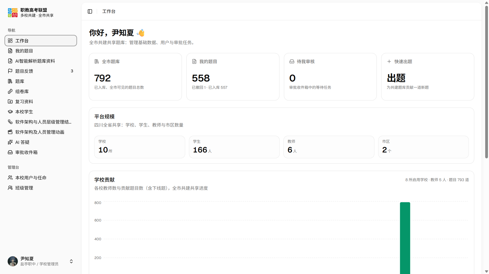

# 绵阳市中职共建题库

[myquiz.cn](https://myquiz.cn)



## 项目结构

- 仓库根目录：**Next.js 16** 打造的网页端（教师 / 管理端）
- `mianyang_quiz/`：**Flutter** 打造的学生端（Windows / Android）
- `supabase/migrations/`：数据库迁移（按序号执行）
- 两端共用同一个 Supabase 后端；数据库函数、行级权限与业务口径都在迁移里

## 启动命令

### 1. 网页端（Next.js）

```bash
npm install
npm run dev          # http://localhost:3000
```

需要 `.env.local`（不入库，向管理员索取）。首次拉代码先 `npm install`；`npm run dev`
启动后会把网页端和 API 一起跑在 3000 端口。

### 2. 客户端（Flutter）

另开一个终端（**网页端要先启动**，开发配置默认连 `http://localhost:3000`）：

```powershell
cd mianyang_quiz
flutter pub get
cp config/dev.example.json config/dev.json          # 第一次：填上真实配置（配置不入库）
$env:CL = "/utf-8 /D_SILENCE_EXPERIMENTAL_COROUTINE_DEPRECATION_WARNINGS"
flutter run -d windows --dart-define-from-file=config/dev.json
```

Android 把 `-d windows` 换成设备号（先 `flutter devices` 看有哪些）：

```powershell
flutter run -d <设备号> --dart-define-from-file=config/dev.json
```

**中文 Windows 上 `$env:CL` 不能省，且必须从 PowerShell 设**（Git Bash 会做路径转换）。
客户端细节、测试与打包见 [`mianyang_quiz/README.md`](./mianyang_quiz/README.md)。

### 3. 两个项目同时运行

准备两个终端：

| 终端 | 命令 | 作用 |
| --- | --- | --- |
| 终端 1（仓库根目录） | `npm run dev` | 网页端 http://localhost:3000 |
| 终端 2（`mianyang_quiz/`） | `flutter run -d windows --dart-define-from-file=config/dev.json` | Windows 客户端 |

客户端的 `config/dev.json` 里 `API_BASE_URL` 保持 `http://localhost:3000`，
`SUPABASE_URL` 指向线上数据库（见 `config/dev.example.json` 的说明）。
