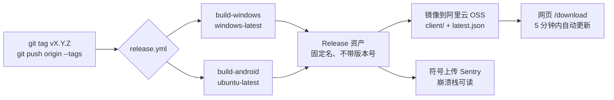

# 新一代信息技术赛道：移动应用开发与服务类

四川省职业院校技能大赛：深入贯彻《教育强国建设规划纲要（2024-2035 年）》， 落实《2026 年世界职业院校技能大赛实施方案》（教职成函〔2026〕 6 号）部署，做好与世界职业院校技能大赛赛制衔接，摸清各地 各校参赛意愿和赛队规模，统筹赛道（组）设置、承办院校安排 和参赛名额分配，决定开展 2026 年四川省职业院校技能大赛预 报名工作。

![[a3372db866d785cc1697e579f39b5848.png]]
# 领域类别

- 移动端界面设计（金子轩：美工、项目经理）
- 移动应用产品前端开发
- 移动产品应用测试
- 移动产品实施运维
- 移动产品营销与推广（Figma做个海报，AI做）
- 移动应用信息服务

# 企业真实开发流程

- 比赛要求：移动应用开发赛项要求选手完成一个app从原型设计、界面实现、功能开发到自动化测试的全流程
- 这个赛项的内容是把一个APP**从无到有**，完整开发的一个过程。比赛期间划分为四大模块：
	- **原型设计**：一个人有了想法之后（尹老师和他的高考生们想解决中职无优秀题可练的问题：**解决什么问题**），把这些**需求**（项目经理：金子轩）列成一个列表，通过专业的设计软件（Figma）将它可视化（设计稿）（美工：金子轩）
	- **界面实现**：拿到专业的设计稿之后，通过编写代码来还原设计稿的细节，实现交互效果（开发人员：赵文俊、陈明霖）
	- **功能开发**（耗时最多、最有价值：解决问题）：对软件的业务流程进行开发，比如登录注册等（开发人员：赵文俊、陈明霖；项目经理：金子轩协调、管理人员，推动项目按期进行并交付产品）
	- **自动化测试**：产品上线之前，在交给用户使用之前，编写测试代码进行测试，模拟各种可能会发生的极端环境来测试这个应用（AI：DeepSeek Harness）

# 项目介绍

> Chrome浏览器新建标签页分组：批量管理标签

- 网站（教师 / 管理端）：https://myquiz.cn/
- 软件（学生端）：Windows 安装包与 Android APK —— 网站首页「下载」页（/download）
- 源代码：网站 `yinleiCoder/mianyang-quesiton-bank`；APP `yinleiCoder/mianyang-quiz`

> **一句话介绍**：**职教高考联盟**是一个「多校共建、全市共享」的中职题库系统 —— 教师在网页端用 AI 把纸质卷变成题、两级专家审核后组卷考试；学生在 Windows / Android 客户端刷题、考试、看排行；学情数据自动回流到老师手里。**出题 → 审题 → 组卷 → 考试 → 练习 → 讲评 → 再练**，一个闭环。

## 一、解决的核心问题

中职学生"没有好题或原创优质题可练"，根子不在学生，而在**题源的生产与流转方式**。我们调研到的五个真实痛点，就是产品的五个发力点：

| #   | 中职教育现状的真实痛点                                                 | 本产品的解法                                                                                                                                   |
| --- | ----------------------------------------------------------- | ---------------------------------------------------------------------------------------------------------------------------------------- |
| 1   | **优质题源散落各校、无法共享**：好题锁在某位老师的电脑里、某个学校的群里，换了学校就归零，同一个知识点全市反复造题 | 建**全市共享题库**：一道题入库、全市学校可见可组卷；按「公共学科 / 专业大类 / 专业 / 课程」四层知识树组织，各校在同一棵树上共建，越用越厚                                                              |
| 2   | **质量参差、无人把关**：错题错答案直接进学生练习册，口头教研形同虚设                        | **两级审批**（学科教研组长 → 市级专家）通过才入库；改版必须重新审批，历史版本全留痕——谁出的、谁审的、什么时候审的都可追溯                                                                        |
| 3   | **纸质卷 / Word 转成数字题是纯人力活**：一套卷手录一天，还常错行、漏答案、断行               | **AI 整卷导入**：上传 PDF / Word / 拍照扫描件（扫描全能王APP），自动切页、识别题型与选项、抽取答案和解析、合并跨页被切断的题、卷内去重、与库里已有题查重，教师只做「校对 + 勾选」                                   |
| 4   | **出题、组卷、考试、讲评各用一套工具**：Word 排版、手动算分、Excel 排行、讲评靠投屏念          | **全链路闭环**：题库 → 拖拽组卷（自动算分、导出标准 PDF 卷与独立答案页）→ 下发考试（客观题自动判分）+ 手工评分板 → 排行榜 → 讲评大屏（一题一屏）→ 易错题 → 针对性练习                                         |
| 5   | **学情数据靠手工统计、到不了学生手里**：考完只有一张分数表，学生不知道自己差在哪                  | **数据自动回流**：班级报告、选项分布、易错题、四档排行榜（全班·全校·全市·全省）、AI 班级诊断报告；学生端同步看到自己的正确率、错题本、科学抽题练习、遗忘曲线（ 艾宾浩斯记忆曲线揭示了人类遗忘的规律：遗忘速度先快后慢，通过科学复习可以显著延缓遗忘，提高记忆效率。） |

## 二、网站（教师 / 管理端 · Next.js）的特点与亮点

1. **AI 整卷导入，把"存量卷子"变成"数字题库"**
   浏览器里直接解析 PDF（含扫描件、拍照照片），自动判定单双栏、切图、逐页送 AI 识别；识别结果自动对齐题型、选项、答案、解析与三级难度；跨页题自动合并、卷内重复自动去重、与库内已有题按三档相似度（高度相似 / 较相似 / 供参考）提示，避免"全市撞题"。
   **密钥与费用不经本站**：每位教师填自己的 AI 密钥，请求由浏览器直达大模型，站点不保存任何密钥、也不承担调用成本；多标签页同时解析有租约互斥，断点可续。
2. **两级审批 + 协同组卷，多校协作有秩序**
   组长流转、专家入库两个动作都是一键；市级专家可分卷给任意教师协同出卷（按"大题内题号区间 + 目标分"分派，多人同时编辑不互相覆盖）。审批记录、操作审计、题目申诉、用户反馈全部可查。
3. **专业级排版输出，直接能印**
   一键导出标准格式试卷 PDF（中文自动折行、行首禁则、答案与正卷分离），支持打印、讲评大屏、讲义模式；试卷分值支持「每题 / 每空 / 每小问」三种口径，三空填空题不再算错分。
4. **学情分析到"可行动"粒度**
   不只给平均分：给每道题的选项分布与错误率、每个知识点的掌握度、每个学生的答卷与失分点；AI 报告按班成文，学生一律匿名编号，喂模型的只有统计数据、不含任何姓名。
5. **教务与资料中心一体**
   城市 / 学校 / 班级 / 科目树 / 标签 / 用户 / 审批 / 审计日志 / 反馈九个管理后台页面，学校与权限都能自助维护；复习资料区支持整本教材、整套卷子（单份最大 2GB）直传与下载，学生端可直接在软件内打开。

## 三、软件（学生端 · Flutter，Windows + Android）的特点与亮点

1. **双端同源、随时可练**：同一套代码出 Windows 与 Android 安装包——机房电脑、宿舍笔记本、随身手机都能练，界面适配手机竖屏与 1280×800 桌面窗口。
2. **三种练习模式 + 背题模式**：即时反馈（边做边看解析）、整卷批改（做完一次交）、顺序练习（不记成绩纯过题，一般给老师讲练使用），另有只翻卡不发起的"背题模式"——刷题和记忆分开。
3. **越练越懂你**：错题本自动收集、收藏夹、遗忘曲线（按时间桶给出该复习的题）、每日趋势与学习热力图，答案即时反馈时正确答案来源可追溯。
4. **考试与考场一致**：按试卷时长作答、考场草稿本地留存断网不丢、交卷后即时出分与排名、能看整卷选项分布与自己的排名位置；考试记录永久可回看复盘。
5. **AI 答疑内嵌**：做题时随时唤起 AI 讲解，不用切出应用（不用手机号接收验证码，学校规定不能携带手机，一般针对windows）。
6. **离线友好与自动更新**：试卷 PDF / 资料可下载缓存复用；启动自检新版本并引导更新；安装包走国内成都 OSS（实测 7~9.6MB/s），APK 同时提供 GitHub 镜像，下载页印出 SHA-256 让用户自行核对。
7. **工程纪律（评委可查）**：单文件 ≤200 行、强制分层与禁用 API 由自研架构检查脚本 `dart run tool/check_architecture.dart` 把关；57 个单元测试 + 6 个集成测试；GitHub Actions 一键产出签名校验过的 Windows 安装包与分 ABI 的 APK。

## 四、技术与工程亮点（评委视角）

| 亮点                             | 说明                                                                             |
| ------------------------------ | ------------------------------------------------------------------------------ |
| 安全边界在数据库（Supabase内置Postgresql） | 客户端和浏览器**只能读表**，所有写操作走数据库函数（RPC）+ 行级安全策略（RLS）；前端拿不到越权数据，靠的是 SQL 而不是 UI 判断      |
| 登录校验 0 网络往返                    | 用 JWT + JWKS 本地验签替代逐页请求鉴权服务，首屏 TTFB 从 3.3s 降到 24ms（流式渲染 + Suspense 骨架）         |
| 大模型在浏览器里用                      | PDF 解析、AI 识别全部在前端完成，密钥不出用户浏览器、站点零密钥成本 —— 既省钱又是隐私最优解                            |
| 一致性靠自动化守住                      | 37 项 PDF 导出断言（折行/禁则/正卷不含答案/缺字）、45+ 手机号断言、导入流水线断言、重试安全性断言，全在 `npm run test:*` 里 |
| 开源可复现                          | 前后端与客户端全部代码托管在 GitHub，CI/CD 自动构建发布，任何学校都能按同一套方式自建                              |

## 五、核心卖点（对外推广直接用）

1. **一套系统顶三套**：题库管理 + 组卷考试 + 学生刷题客户端，不需要再拼 Word、Excel、多个刷题 App。
2. **AI 把存量卷子一次搬进数字世界**：原先"一套卷录一天"的活儿变成"十几分钟校对一遍"，学校已有的题源立刻可用。
3. **越用越厚、越用越准**：多校共建 + 两级审核 + 查重防撞题，题量和质量同时滚雪球，而不是各校各出一遍。
4. **学生真的愿意用**：即时判分与解析、排行榜、错题本、遗忘曲线、Windows/Android 都能用——刷题不再是枯燥的纸面作业。
5. **学校零门槛落地**：一所学校就能自建自用，多校加入自动形成联盟；托管在云服务上，无需自购服务器、无需专职运维。
6. **数据安全可控**：答案与正卷分离、AI 密钥不入库、操作全程审计、AI 报告全部匿名——能过学校与教研部门的合规审查。

## 六、落地方案（三步）

1. **建库**：学校管理员开通学校、班级与科目树；教师把本校存量的 PDF / Word 试卷批量导入，学科教研组长、专家审核入库。
2. **用起来**：教师按知识点组卷 → 下发班级 → 学生在 Windows 或 Android 端考试/练习 → 教师看报告与排行 → 讲评课投屏讲易错题。
3. **连成联盟**：多所学校加入同一题库，题目与学情按权限互相可见，形成"市级优质题池"。

# 系统账号

| 角色               | 邮箱或手机号                 | 密码             |
| ---------------- | ---------------------- | -------------- |
| 系统管理员            | 1099129793@qq.com      | yl13795950539  |
| 盐亭职校-学校管理员       | yl1099129793@gmail.com | yl13795950539  |
| 盐亭职校-学科教研组长（计算机） | yinlei19980505@qq.com  | yl13795950539  |
| 盐亭职校-学生（计算机）     | 18282554435            | yl13795950539  |
| Supabase账号       | yinlei19980505@qq.com  | Yl13795950539@ |
# Github 仓库代码托管

- [职教联盟官网代码](https://github.com/yinleiCoder/mianyang-quesiton-bank)
- [APP软件源代码](https://github.com/yinleiCoder/mianyang-quiz)
# 环境搭建

[[Flutter环境搭建]]

# 参考学习文档资料

- [Flutter 开发文档](https://docs.flutter.cn/?_gl=1*14210ds*_ga*MTA3Mzk3NzYyNy4xNzkxNDYyMjE0*_ga_HPSFTRXK91*czE3OTE0NjIyMTMkbzEkZzEkdDE3OTE0NjI1MjQkajU1JGwwJGgw)
- [Open Design](https://open-design.ai/zh/)
- [Open Design 配置DeepSeek](https://open-design.ai/zh/agents/deepseek-design/)
- [Material Design 3](https://m3.material.io/)
# 指导教师

尹老师（13795950539）、勾老师
# 组员分工：明确岗位职责、团队协作精神

- 软件的**宗旨**：解决什么问题
- 比赛的**要求**：明确岗位职责、团队协作精神
- 分工：

| 岗位      | 负责人              | 职责                                                                    |
| ------- | ---------------- | --------------------------------------------------------------------- |
| 项目经理    | 金子轩              | 和客户（尹老师）多轮沟通，整理需求文档（产品有什么功能、解决什么问题等）；推动项目进行，协调人员分工，保证产品按合同按期交付上线给用户。  |
| 美工      | 金子轩              | 根据需求文档去设计软件的原型（软件长啥样，每个按钮有啥交互效果等），产出**设计稿**，并和客户、项目经理多轮沟通修改，达到客户满意的效果 |
| 开发人员    | 陈明霖              | 设计软件的架构；负责后端开发、数据库设计；负责Flutter与Windows、Android APP的开发。                |
| 开发人员    | 赵文俊              | 负责Flutter与Windows、Android APP的开发；负责网站开发及逻辑功能的实现。                      |
| 自动化测试   | DeepSeek Harness | 在产品发布上线前，找出软件的bug                                                     |
| CI/CD运维 | Github Actions   | 负责测试成功后的软件的持续集成、持续交付、运维                                               |
## 项目经理：金子轩

### 1. 岗位职责（企业级项目流程：从立项到复盘）

本项目是一个**真实上线**的教育系统：网站 myquiz.cn（教师/管理端）+ Windows/Android 学生端 + Supabase 数据库。客户是一线教师，真实用户是中职教师与学生。所以项目经理不是"催进度的人"，而是**对最终交付结果负责的人**——需求、范围、计划、协作、质量、风险、交付、复盘，八件事一件都不能少。

#### 1.1 立项与需求管理

| 要做的事      | 具体做法（本项目）                                                                | 交付物                         |
| --------- | ------------------------------------------------------------------------ | --------------------------- |
| 需求采集      | 与客户（老师）多轮沟通，把"中职学生没有好题可练"翻译成可开发的需求                                       | 需求池（飞书多维表格 / GitHub Issues） |
| 角色与场景梳理   | 梳理 6 类角色：系统管理员、学校管理员、教研组长、市级专家、教师、学生；梳理核心链路「出题 → 审批 → 组卷 → 考试 → 练习 → 讲评」 | 用户角色图谱 + 业务流程图              |
| 需求文档（PRD） | 每个功能写清「谁、在什么场景、解决什么问题、验收标准」，例如"两级审批：组长流转、专家入库"                           | PRD（含验收标准）                  |
| 需求评审      | 组织客户 + 开发 + 美工 + 测试四方评审，确认唯一口径，避免"开发完才发现不是客户要的"                          | 评审纪要 + 确认记录                 |

#### 1.2 范围与优先级（取舍）

- **MVP 排序**：先打通「题库 + 两级审批 + 学生刷题」，再上「组卷考试 + 学情分析 + AI 报告」。
- **明确写"本期不做"清单并说明理由**。真实案例：教学动画功能做完 M0–M4 后，判断"制作放在本站会加大复杂度"整体砍掉——PM 的价值一半在加需求、一半在砍需求，每次砍单都要留决策记录，避免反复。
- **需求变更走变更流程**：影响哪些功能、影响几天工期、是否影响比赛演示，记录在案后再改。

#### 1.3 计划与里程碑

- 按赛项四模块排期：**原型设计（Figma）→ 界面实现 → 功能开发 → 自动化测试**，每个阶段都有可见交付物（设计稿 / 可运行页面 / 可安装包 / 测试报告）。
- 里程碑验收口径（本项目真实可查）：网页端 `npm run build` 通过；Flutter 端 `flutter analyze` 零 error + `dart run tool/check_architecture.dart` 通过 + 单元测试通过；能打出签名 APK 与 Windows 安装包；下载页三个资产名与发布产物逐字一致。
- 维护任务看板：需求 → 任务 → 负责人 → 截止日 → 状态，每周更新进度与风险。

#### 1.4 团队协作

- **每日站会 15 分钟**（昨天做了什么 / 今天做什么 / 卡在哪），每周一次协作复盘。
- 明确边界：陈明霖负责架构、后端与数据库；赵文俊负责网站与客户端逻辑；美工负责原型与设计系统；自动化测试与 CI/CD 由 AI / 工具承担，PM 负责接住"人工判断"的部分（验收、优先级、口径）。
- **用 GitHub 做单一事实源**：需求 = Issue、代码 = PR、版本 = Release；设计变更在 Figma 评论留痕，不在微信里口头改。

#### 1.5 质量与验收（UAT）

- 发布前用四个角色账号走全流程验收（系统管理员 / 学校管理员 / 教研组长 / 学生），覆盖：登录、出题、审批、组卷、下发考试、学生作答、成绩与排名、资料下载。
- **验收清单化**：每条需求对照验收标准打勾；发现问题开 Issue 并指定负责人与截止时间。
- **质量红线**：涉及学生答案与成绩的功能，必须"答案与正卷分离""AI 报告匿名""关键操作有审计"。

#### 1.6 风险管理

| 风险                                         | 应对                                                      |
| ------------------------------------------ | ------------------------------------------------------- |
| 账号与密钥安全                                    | 数据库、云服务、AI 密钥、测试账号单独管理；**公开仓库里不放明文密码**（当前文档中的明文账号即待整改项） |
| 外部依赖（Supabase / 阿里云 OSS / Vercel / GitHub） | 只影响可用性、不影响数据正确性；关键数据有备份与导出方案                            |
| 进度风险                                       | 比赛时间固定，功能必须可裁；做不完先保主链路（练习 + 考试 + 排行）                    |
| 人员风险                                       | 关键人忙/请假时，需求文档与设计稿必须能让他人接手                               |

#### 1.7 交付与运维

- **发布节奏**：客户端打 tag → GitHub Actions 构建 → 镜像到 OSS → 网页端下载页自动更新。
- 每个版本写**发布说明**（改了什么、修了哪些 bug）；下载页资产名两端逐字一致（本项目踩过的坑）。
- 上线后盯 Sentry 错误与用户反馈，按"影响面 × 频率"排修复优先级。

#### 1.8 干系人与比赛材料

- 对客户：每周进展汇报 + 演示，及时确认"这是不是你要的"。
- 对评委与指导教师：准备需求文档、原型链接、演示脚本、答辩 PPT、卖点一页纸（本文件「项目介绍」章节即素材）。
- 比赛要求"明确岗位职责、团队协作精神"——职责要写成**可检查的清单**，协作要留有痕迹（Issue、评审纪要、提交记录）。

#### 1.9 复盘

每个阶段结束做一次复盘：做对了什么、哪里返工、下次怎么改；把结论沉淀成团队约定（例如"设计稿统一 390×844""接口约定先写文档"）。

### 2. 需要的软件

| 用途      | 推荐软件                                                                         |
| ------- | ---------------------------------------------------------------------------- |
| 沟通协作    | 飞书 / 钉钉 / 企业微信（群、会议、文档一体）、腾讯会议                                               |
| 需求与任务管理 | GitHub Issues + Projects（与代码同源）、飞书多维表格（甘特/需求池）、Teambition / Tapd（企业级）        |
| 文档与知识库  | 飞书文档、语雀、Notion；本项目资料用 Markdown + Obsidian 维护（`docs/移动软件开发/` 下已是 Obsidian 仓库） |
| 流程图与脑图  | XMind / 幕布（脑图、大纲）、ProcessOn / draw.io（流程图、泳道图）、Mermaid（Markdown 内直接画时序图）     |
| 设计评审    | Figma（查看与评论设计稿）、Open Design（AI 生成初稿）                                         |
| 演示与录屏   | PowerPoint / WPS / Keynote、OBS（演示录屏）                                         |
| 版本与发布   | GitHub Releases（客户端自动更新读 tag）、Vercel 控制台（网页端部署与回滚）                           |
| 数据验收    | 浏览器 + 四个角色测试账号、Excel / 多维表格做验收清单                                             |

## 美工：金子轩

### 1. 岗位职责（做什么、交付什么）

本项目的美工不只是"画图的"：要同时承担**原型设计、设计系统、视觉交付、跨端一致性、营销物料**五件事，并且保证设计稿能被开发 **100% 还原**（Flutter 双端 + 网页端）。

| #   | 职责      | 具体做什么（本项目）                                                 | 交付物 / 验收标准                                     |
| --- | ------- | ---------------------------------------------------------- | ---------------------------------------------- |
| 1   | 需求转设计   | 与项目经理、客户（尹老师）对齐后，把需求文档转成信息架构与用户流程                          | 站点地图 + 核心流程图（登录 → 出题 → 审批 → 组卷 → 考试 → 刷题 → 排行） |
| 2   | 原型设计    | 低保真线框 → 高保真设计稿；关键流程用 Figma Prototype 连线成可点击原型              | 可点击原型（答辩现场直接演示，无需真机）                           |
| 3   | 设计系统    | 建组件库（按钮 / 输入框 / 卡片 / 列表项 / 答题面板 / 标签 / 空状态），定颜色、字号、间距、圆角令牌 | 组件库页面 + 设计规范页（Figma Variables）                 |
| 4   | 双端适配    | 手机竖屏 390 × 844、桌面 1280 × 800 两套画板；桌面端处理宽屏留白与信息密度           | 两套画板 + 适配说明                                    |
| 5   | 状态与边界设计 | 除"正常态"外还要设计：空状态、加载骨架、错误态、无权限、断网、超长题干折行、复合题材料排版、图片/公式题、深色模式 | 状态清单 + 对应稿件                                    |
| 6   | 切图与标注交付 | 图标、插图、空状态图切图（注意网页端 PDF 导出不支持 WebP 的坑）；标注间距、字号、颜色           | 切图包 + Figma Dev Mode 标注                        |
| 7   | 视觉走查验收  | 开发完成后在真机与桌面端逐页走查：字号、间距、颜色、点击态、折行、滚动                        | 走查清单 + Issue 列表                                |
| 8   | 营销与答辩物料 | 海报、宣传图、下载页视觉、答辩 PPT 母版、演示脚本配图（对应赛项"营销与推广"模块）               | 海报尺寸变体 + 答辩母版                                  |
| 9   | 设计沉淀与协作 | 设计变更同步开发；维护设计规范文档；文件命名与页面组织清楚，便于交接                         | 设计规范文档 + 变更记录                                  |

**协作纪律三条**：

- 设计稿**先评审后开发**，避免"边做边改"；
- 任何设计变更在 Figma 评论里留痕，并同步项目经理与开发；
- 设计不越界：不自行改动产品逻辑与关键文案口径（如"审核通过才入库""答案不进正卷"），有疑问回到 PRD 确认。

### 2. 常见美工软件一览（按用途分）

| 用途                  | 常见软件                                                         | 特点与取舍                                                                                                                                                                                 |
| ------------------- | ------------------------------------------------------------ | ------------------------------------------------------------------------------------------------------------------------------------------------------------------------------------- |
| 原型 + UI 设计（**主战场**） | **Figma**（我们采用）、即时设计、MasterGo、墨刀、Axure RP、Sketch、蓝湖、Framer   | Figma 浏览器端免安装、多人实时协作、组件与自动布局能力最强，且能直接交付给开发；即时设计 / MasterGo 是国内同类（网络与付费更友好）；墨刀偏快速原型；Axure 偏重交互文档；Sketch 仅限 macOS；Adobe XD 已停止开发，不建议新项目采用                                               |
| AI 驱动设计（设计系统 → 代码）  | **Open Design**（我们采用）、v0.dev、Claude Design、Galileo AI        | 用自然语言 + 设计系统直接生成界面与前端代码。Open Design 是**开源的 AI 设计桌面应用**（[GitHub](https://github.com/nexu-io/open-design)，定位为 Claude Design 的开源替代）：可接自己的模型、设计系统可挂 GitHub、产出 React/Tailwind 代码，适合"设计即实现" |
| 位图处理 / 修图 / 合成      | Adobe Photoshop、Affinity Photo、GIMP（开源）                      | 抠图、界面配图、海报底图                                                                                                                                                                          |
| 动效与交互演示             | Figma Prototype、After Effects + Lottie、Principle、Rive、Jitter | 答辩演示优先用 Figma Prototype（零导出成本）；复杂动效再用 AE 出 Lottie                                                                                                                                     |
| 海报与营销物料             | **Figma**（做海报）+ Canva / 稿定设计（模板）、AI 生图（即梦、纳米AI 等）            | 对应赛项的"移动产品营销与推广"模块                                                                                                                                                                    |

### 3. 我们的选择之一：Figma（人看的设计：原型、评审、标注）

1. **Windows 可用、免安装**：浏览器直接打开，机房电脑也能用，不占用本机性能（本项目开发机为 Windows，Sketch 仅限 macOS，直接被排除）。
2. **多人实时协作**：项目经理、美工、开发人员可同时在一个文件里看稿、评论、改稿，与"客户（尹老师）多轮沟通修改"的赛项要求天然契合；评论可以直接钉在具体元素上，避免"截屏 + 微信描述"。
3. **组件化与自动布局**：设计稿按组件（按钮 / 卡片 / 列表项 / 输入框）维护，改一处全站生效——这正是本项目 Flutter 端与网页端都能落地的关键（两端都是组件化实现）。
4. **开发可直接取用**：Figma 的 Dev Mode 能查看间距、字号、颜色与导出切图，开发人员不需要再猜"这里是 12 还是 16"。
5. **教育免费 + 插件生态**：学生教育版免费；图标、中文排版、批量切图等插件齐全。

### 4. 我们的选择之二：Open Design（AI 驱动，直接产出代码）

> 定位差别：**Figma 管"人看的设计"**（原型、评审、标注、切图）；**Open Design 管"机器能落地的设计"**（设计系统 → 可运行的前端代码）。两者不重复，是接力关系。

[Open Design](https://github.com/nexu-io/open-design) 是开源的 AI 设计桌面应用，用自然语言驱动 agent 产出界面。本项目用它做三件事：

1. **设计系统变成"活资产"**：颜色、字号、间距、组件规范集中维护，可挂到 GitHub 做版本管理；还支持从网址、离线 `.fig` 文件或浏览器里截下的一页提取真实品牌规范（0.12 起）。这正好对上本项目的代码约定——颜色集中一处定义、深浅色模式自动切换。
2. **设计即代码，减少"设计稿 → 代码"的翻译损耗**：它产出的是 React + Tailwind 组件，与网页端 **Next.js 16 + Tailwind v4 + shadcn** 的技术栈同源，可直接复用；Flutter 端再按 Material 3 规范转译（画板仍按 390 × 844 出稿）。
3. **答辩与推广物料直接出厂**：支持把设计稿/牌组导出为真正的 PPTX、PDF（0.13 起），比赛用的设计说明、原型讲解页不必再手工排版。

工程侧要点：

- **开源、模型可自带**（BYOK，也可用官方 AMR）；Windows 有便携版，与比赛机环境兼容，不依赖 macOS。
- 支持 **MCP 与插件（Skills）**：我们把自己积累的"题库类界面规范"沉淀成插件，后续新页面按同一套风格生成，风格不漂移。
- **AI 产出仍需人工过一遍**：生成的代码只是初稿，最终以 Flutter 端 `tool/check_architecture.dart` 与网页端构建/lint 为准——设计可以 AI 生成，交付质量仍由人把关。

### 5. 设计稿与本项目代码的约定（保证设计稿能 100% 落地）

| 项目   | 约定                                            | 与代码的对应                                                                   |
| ---- | --------------------------------------------- | ------------------------------------------------------------------------ |
| 画板尺寸 | 手机竖屏 **390 × 844**；桌面窗口另出 **1280 × 800**      | 与 Flutter 端 `ScreenUtil` 的 `designSize = Size(390, 844)` 完全一致，开发按 1:1 还原 |
| 设计体系 | 一律 **Material 3**（圆角、层级、状态色）                  | Flutter 端与网页端均为 M3 / Tailwind 令牌，不另造体系                                   |
| 字重   | 只允许 **w400 / w700** 两档                        | Flutter 架构检查脚本强制，设计稿超出两档开发无法实现                                           |
| 颜色   | 全部走主题色令牌（seed color + 语义色：正确/错误/警告）           | 代码里颜色集中在一处定义，深浅色模式可自动切换                                                  |
| 图标   | 统一 **24 × 24 线性图标**                           | 网页端用 lucide 图标库、Flutter 用内置 Material 图标，均有现成实现                           |
| 设计系统同步 | Figma Variables / Open Design 的设计系统（可挂 GitHub 版本化） | 两端共用一套颜色与字号令牌，改一处两端生效 |
| 代码产出 | Open Design 生成 React + Tailwind 组件 | 网页端可直接采用；Flutter 端按 M3 规范 + 390×844 画板转译 |
| 交付物  | ① 可交互原型（Figma Prototype 连线）② 组件库页面 ③ 各页面标注与切图 | 原型用于答辩演示与客户评审；切图直接进题库媒体与 App 素材                                          |

### 6. 答辩与推广物料

- **原型演示**：Figma Prototype 串起「登录 → 选科目 → 组卷 → 刷题 → 交卷 → 看排行」主流程，比赛现场无需真机也能讲清交互。
- **营销海报**：Figma 出主视觉 + Canva / 稿定套模板出尺寸变体，AI 生图负责背景与插画；对应赛项"移动产品营销与推广"模块。
- **AI 辅助设计记录**：用 Open Design 生成"设计系统说明 / 界面演进"页，并导出 PPTX、PDF 作为答辩与推广材料——既展示设计能力，也展示"用 AI 工具提效"的过程证据。
- **设计说明页**：在 Figma 里单独一页放"设计规范（色彩 / 字号 / 间距 / 组件）"，答辩时可直接投屏讲设计思路。

## 开发人员：陈明霖

## 开发人员：赵文俊

## 自动化测试：DeepSeek Harness与Flutter测试

本岗位由 **AI（DeepSeek Harness）承担**：产品发布上线前找出 Bug，并把"人肉点一遍"变成**可重复执行的断言**。参照 [Flutter 官方测试文档](https://docs.flutter.cn/testing/overview/) 的三层（单元测试 / Widget 测试 / 集成测试），本项目另有网页端断言脚本、静态架构守卫与 CI 闸门，形成四层防线。

### 1. 岗位职责（测试左移：从需求评审到上线复盘）

#### 1.1 测试策略：四层防线，各管一段

| 层级            | 测什么                     | 本项目怎么落地                                                             | 数量级                                  |
| ------------- | ----------------------- | ------------------------------------------------------------------- | ------------------------------------ |
| **静态守卫**      | 代码规范、架构分层、危险 API        | `flutter analyze`（零 error）+ `dart run tool/check_architecture.dart` | 每次提交                                 |
| **单元测试**      | 纯逻辑：判分、手机号、遗忘曲线、草稿、错误映射 | `flutter test`，纯 Dart、不依赖界面与网络                                      | `mianyang_quiz/test/` 共 **62 个测试文件** |
| **Widget 测试** | 单个界面/组件在给定数据下的渲染与交互     | `flutter test`（`WidgetTester` + Fake 数据），页面与通用组件逐个覆盖                | 同上，`test/pages/`、`test/widgets/`     |
| **端到端 / 集成**  | 真机/真浏览器上跑完整用户旅程         | `flutter test integration_test/`（6 个场景）+ 网页端零依赖 CDP 脚本 + 免登录夹具页     | 6 个集成场景 + 6 组断言脚本                    |

分工原则：**能写成断言的绝不靠人眼**；只有"体感/视觉/真机兼容性"才留给手工走查，其余全部自动化回归。

#### 1.2 Flutter 端三层测试（对应官方文档）

**① 单元测试（Unit Test）——纯 Dart，毫秒级，最省钱的第一道网**
`flutter test` 直接跑，不需要设备。本项目把**所有能纯函数化的逻辑抽到 `lib/utils/`（禁 import Flutter）**，所以都能单测：

| 测试文件                                                                     | 覆盖的业务不变量                                          |
| ------------------------------------------------------------------------ | ------------------------------------------------- |
| `test/utils/answer_grader_test.dart`                                     | 判分镜像：期望值取自**真实数据库函数**的结果，保证 App 抢先显示的对错与服务端权威判分一致 |
| `test/utils/phone_test.dart`                                             | 手机号账号规则（含合成邮箱 `…@phone.myquiz.cn` 的识别与折叠）         |
| `test/utils/subject_tree_test.dart`、`tag_tree_test.dart`                 | 科目树/标签树的祖先反推与选中态                                  |
| `test/utils/forgetting_curve_test.dart`、`node_accuracy_test.dart`        | 遗忘曲线分桶、知识点掌握度                                     |
| `test/utils/option_order_test.dart`                                      | 选项乱序只物化一次（刷新不跳位）                                  |
| `test/state/practice_draft_store_test.dart`                              | 组卷条件草稿：勾选题后 source/limit/轮次的联动规则                  |
| `test/apis/exam_draft_service_test.dart`、`auth_refresh_client_test.dart` | 断网草稿存取、401 后刷新并只重放一次                              |
| `test/utils/error_mapper_test.dart`、`error_handling_test.dart`           | 预期内错误不上报、无人接住才上报的两层策略                             |
| `test/values/*`                                                          | 主题/语义色/字重令牌（防止"对错用色"被误改）                          |

**② Widget 测试——给界面喂假数据，点它、断言它**
不连后端，直接构造数据驱动组件，验证"该出现的出现、该禁用的禁用、点了会怎样"：

- 主壳与导航：`app_shell_test.dart`、`side_nav_shortcuts_test.dart`（桌面快捷键）、`share_links_clipboard_test.dart`（剪贴板深链）。
- 登录注册：`auth_pages_test.dart`（校验提示、加载态、错误态）。
- 题库与筛选：`bank_pages_test.dart`、`bank_pull_refresh_test.dart`、`subject_cascade_field_test.dart`。
- 练习答题（最核心）：`practice_runner_test.dart`、`answer_sheet_test.dart`（答题卡）、`practice_feedback_bar_test.dart`（对错反馈）、`practice_timer_test.dart`、`practice_sequential_test.dart`、`practice_page_resume_test.dart`（杀进程后还能续）、`practice_ended_test.dart`。
- 考试：`exam_runner_test.dart`、`exam_stage_test.dart`、`exam_timer_test.dart`、`exam_result_page_test.dart`。
- 记录/学情/资料：`records_page_test.dart`、`session_review_page_test.dart`、`paper_leaderboard_page_test.dart`、`paper_analysis_page_test.dart`、`my_standing_page_test.dart`。
- 组件级：`question_view_test.dart`（六种题型渲染）、`accuracy_chip_test.dart`、`practice_heatmap_test.dart`、`fade_slide_in_test.dart`。

为什么要写 Widget 测试而不是只看截图：**上面这些状态（错题反馈、超时、断网续答、空列表）在真机上很难复现，但用假数据一行代码就能构造**——这正是自动化回归最大的价值。

**③ 集成测试（Integration Test）——真机跑完整旅程**
`flutter test integration_test/`（需设备/模拟器），6 个场景：

| 场景 | 说明 |
| --- | --- |
| 登录 → 选科目 → 组卷 → 答题 → 交卷 → 看结果 | 学生主链路（写库测试需显式 `TEST_WRITE: true`，默认只读，防止污染线上数据） |
| 只读后端连通性 | 只读场景，验证 RPC 签名与权限口径 |
| 练习/考试/资料/反馈 | 各自独立文件，避免相互污染 |
| **Windows 上必须一个文件一次跑** | 桌面端进程模型限制，写进执行手册，避免"一起跑就挂"被误判为 Bug |

#### 1.3 网页端测试：Node 断言脚本 + 零依赖浏览器自动化

网页端**不引测试框架**（不增加依赖），全部用 `node:assert` + 自研 loader（`scripts/alias-loader.mjs` 解决 `@/` 别名，`scripts/jsx-loader.mjs` 用仓库自带 Babel 现场编译 JSX），`npm run test:*` 一键跑：

| 命令 | 断言内容 |
| --- | --- |
| `npm run test:pdf` | **37 项**：真实渲染一份 PDF 再用 pdfjs 抽回文字核对——中文折行不越版心（595.28−2×40）、行首禁则、**正卷绝不能出现答案**、图片嵌入比例、缺字自查 |
| `npm run test:phone` | **45+ 项**：手机号/合成邮箱的识别、格式化、折叠展示 |
| `npm run test:import` | 导入流水线：题型/难度别名归一、选项前缀剥离、空位计数、同页去重、卷头数值缺省、"未知 flag 必须被白名单挡掉"（否则整页落库失败） |
| `npm run test:ai-report` | **11 项**：喂给模型的 system 提示逐字节稳定（否则缓存与复现失效）、提示词必须含"不许猜姓名"且不含卷名 |
| `npm run test:retry` | **网络异常不得进入重试列表**——这条防的是"写操作被执行两次"这种最贵的错 |
| `npm run test:docx` | Word 解析分段与分批边界（含"批数比段数少一个数量级"的性能断言） |

浏览器端自动化：`scripts/e2e-cdp.mjs` 是**零依赖**的 Chrome DevTools Protocol 驱动（`open|eval|click|fill|waitfor|shot`），配合四个不用登录的夹具页做可视化验收：`/dev-pdf-export`（PDF 排版）、`/dev-approval-flow`（审批流画布）、`/dev-ai-report`（AI 报告）、`/dev-exam-panel`（考试面板）。

> 已知待办：`/dev-pdf-export`、`/dev-approval-flow` 目前**没有生产环境 404 保护**（另两个夹具页有），上线前需补齐，列入测试清单跟踪。

#### 1.4 静态检查与架构守卫（质量不靠自觉）

- `flutter analyze` **零 error** 才算通过（CI 与本地同一口径）。
- `dart run tool/check_architecture.dart`（**0 = 通过**）是本项目自研的架构守卫，检查：单文件 ≤200 行、禁止 `package:flutter/material.dart`（必须用 `material_ui`，否则转场与 Hero 会静默失效）、分层依赖方向（values ← entity ↔ utils ↔ apis ← state ← widgets ← pages ← router）、widgets 层不得 import apis/state/pages、页面模块之间禁止互相 import、界面层每文件恒 1 个 public class、禁止手写 `part`、字重只允许 w400/w700。
- 网页端用 `npm run build` 做"能不能发"的硬门槛，构建失败即阻断发布。

#### 1.5 专项测试（这个产品的"高危点"清单）

1. **权限与越权**：学生不得看到未出分试卷的答案与选项分布（接口返回统一错误码 `42501`）；教师不得查看非本校/非本班数据；客户端对表只有 SELECT、写操作全部走 RPC——测试要**直接打接口**而不是点界面，证明拦的是数据库不是按钮。
2. **数据一致性**：空位计数 `_{3,}` 与数据库函数同口径；多选判分比对**排序后的数组**（`['A','A'] ≠ ['A']`）；空白归一化用显式码位集合（Dart 正则与 PG `[[:space:]]` 互不包含）；"当天"必须用北京时间口径（`practice_day_start()`），测试要跨零点验证。
3. **异常与弱网**：断网交卷、刷新中断、多标签页同时导入（租约冲突返回 `40001`，这一页结果作废但不报错）、上游 AI 返回空内容（可重试）与非法 JSON（不可重试）必须区分。
4. **兼容性**：Android 多 ABI、Windows 1280×800 窗口、深色模式、超长题干与复合题材料排版、扫描件/图片题渲染。
5. **安全**：发布包必须是**正式签名**（CI 用 `apksigner verify` 拒绝 debug 签名）；密钥不入库、不进日志、不上报第三方。

#### 1.6 缺陷管理与回归

- 发现即开 **GitHub Issue**：复现步骤、期望结果、实际结果、截图/录屏、环境（系统/版本）、严重级别（P0 阻断主链路 / P1 影响功能 / P2 体验 / P3 建议）。
- 修复后**必须补一条自动化断言**（能自动化的一律不回退到人眼），再回归"该用例 + 同层级全量"。
- 每次发版前跑**冒烟清单**：主链路（出题→审批→组卷→考试→学生作答→出分→排行→资料下载）+ 下载页三资产名与 SHA-256 核对。

#### 1.7 准出标准（发布门槛，四条同时满足）

1. `flutter analyze` 零 error、`dart run tool/check_architecture.dart` 通过、`flutter test` 全绿。
2. 网页端 `npm run build` 通过 + `npm run test:pdf` / `test:phone` / `test:ai-report` / `test:retry` / `test:import` 全绿。
3. 集成测试 6 个场景在**待发布版本**上跑过（Windows 逐文件跑、Android 真机一遍）。
4. 无未关闭的 P0/P1 缺陷；已知问题有书面记录并明确"不影响发布"的理由。

#### 1.8 测试报告与复盘

每次发版输出一页报告：跑了什么（层级/数量）、通过了什么、发现并修了什么（按级别统计）、未覆盖的风险与原因、下次补什么。AI 负责**执行与汇总**，**通过/驳回与风险拍板由项目经理和指导教师签字**——AI 找 Bug，人决定能不能发。

### 2. 需要的软件

| 用途                     | 软件 / 工具                                                                     | 说明                                           |
| ---------------------- | --------------------------------------------------------------------------- | -------------------------------------------- |
| AI 测试代理                | **DeepSeek Harness**                                                        | 生成与补充测试用例、跑静态审计与回归、归并缺陷、写测试报告                |
| Flutter 单元 / Widget 测试 | `flutter test` + `flutter_test`（官方）                                         | 不需要设备，CI 与本地同一命令                             |
| Flutter 集成测试           | `integration_test`（官方，配 `flutter drive` 或 `flutter test integration_test/`） | 真机/模拟器跑完整旅程；Windows 一次只跑一个文件                 |
| 静态检查                   | `flutter analyze` + `dart analyze`                                          | 零 error 门槛                                   |
| 架构守卫                   | `dart run tool/check_architecture.dart`（本项目自研）                              | 检查分层、文件行数、禁用 API、命名与字重                       |
| 网页端断言                  | Node.js + `node:assert` + 自研 alias/jsx loader                               | 不引第三方测试框架，`npm run test:*` 一键跑               |
| 浏览器自动化                 | `scripts/e2e-cdp.mjs`（自研，零依赖 CDP）+ Chrome                                   | `open/eval/click/fill/waitfor/shot`，配夹具页验收界面 |
| 接口测试                   | Supabase 控制台 SQL Editor / PostgREST 直调（curl）                                | 越权用例直接打接口，绕过按钮证明 RLS 生效                      |
| 缺陷跟踪                   | **GitHub Issues**（标签：bug / 优先级 / 待回归）                                       | 与代码同仓，修复提交自动关联关闭                             |
| 持续集成                   | **GitHub Actions**                                                          | 每次提交跑 analyze/test，发布流水线自动出签名包               |
| 兼容性                    | Android 模拟器 + 真机、Windows 1280×800 窗口                                        | 双端都要过一遍                                      |
| 性能                     | Flutter DevTools、`flutter drive --profile` 看 99th/worst 帧                   | 关注答题页与长列表滚动                                  |
| 测试报告                   | Markdown（本仓库 docs）+ 图表                                                      | 随发布说明归档                                      |

## CI/CD运维、将错误上报到收集服务：Github Actions、Sentry

本岗位管两件事：**把代码稳定地变成学生能装的包**（CI/CD 持续集成、交付、运维），以及**让线上出的错自己飞回来**（错误上报到收集服务）。一次发布 = `git tag` 一个命令，从构建、签名、出包、分发到上线、监控全部自动完成。

### 1. 岗位职责（从一次提交到线上可用，再到出错可查）

#### 1.1 一条流水线跑完全程（GitHub Actions）

流水线在**客户端仓库** `mianyang_quiz/.github/workflows/release.yml`（约 500 行）；网页端没有自建工作流，构建与部署交给 Vercel（push 即构建）。

| 阶段 | 做什么 | 为什么这么做 |
| --- | --- | --- |
| **触发** | `push: tags: ["v*"]`；另支持 `workflow_dispatch`（只构建、不发 Release） | 一个 tag 出一个版本，包与代码可对应到具体提交 |
| **并行构建** | `build-windows`（windows-latest）+ `build-android`（ubuntu-latest），Flutter 版本钉死 **3.47.0** | 两平台同时出包，版本环境完全一致，避免"我这能跑" |
| **版本号** | 取 tag 作 versionName（去掉 `v`），`--build-number=${{ github.run_number }}` | Android 只允许 versionCode 更大的包覆盖安装，不显式递增用户会看到"应用未安装" |
| **注入配置** | CI 生成 `config/ci.local.json`：`SUPABASE_URL`（反代域名 `api.myquiz.cn`）、`OSS_PUBLIC_HOST`、`API_BASE_URL`/`SHARE_BASE_URL=https://myquiz.cn`、`SENTRY_DSN` | 这些值随包一起发出去（publishable key 本来就印在每个包里），不算机密；**真密钥（OSS AccessKey、AI 密钥）只存在网页端服务端** |
| **出包** | Windows → 目录 zip + Inno Setup `setup.exe`；Android → `--split-per-abi` 三份 APK（arm64-v8a 真机 / armeabi-v7a 老设备 / x86_64 模拟器） | 通用包含三套原生库，其中两份对任何一台机器都是死重量 |
| **守门** | 缺 Android 正式签名 → 打 tag 直接失败；构建前 `keytool -list` 验密钥库与别名；构建后 `apksigner verify --print-certs` 回头看产物，出现 `Android Debug` 即判失败；三份 APK 各有存在性断言 | debug 签名能装能跑、但签名随构建机变，老用户下一版就装不上；少一份 APK 就是"老设备点进去 404" |
| **发 Release** | `needs: [build-windows, build-android]` + `if: github.ref_type == 'tag'`，`permissions: contents: write` | 任一平台失败则整个版本不发布，不做"半套包" |
| **镜像到国内 OSS** | 把资产推到 OSS `client/` 并写 `client/latest.json`；缺密钥不算失败 | 国内直连 GitHub 20 秒拿不到一个字节（实测），镜像后成都 OSS 是 7~9.6MB/s；没配就退回慢线路 |
| **上线** | 网页 `/download` 读 `latest.json`（revalidate 300） | 客户端先发、网页端 5 分钟内自动跟上，不用手动改链接 |

> 资产名**固定不带版本号**（`mianyang_quiz-android.apk`、`mianyang_quiz-windows-x64.zip`、`…-setup.exe`），这样 `/releases/latest/download/<名字>` 永远指向最新版，网页与客户端都能写死链接。**资产名两端逐字一致**——网页端 `app/download/page.jsx` 的常量与客户端 `tool/upload_to_oss.mjs` 推上去的是同一套，改一处必须改另一处，否则点下去就是 404。

#### 1.2 CI：每次提交的自动闸门

- **客户端三条全过才算改完**：`flutter analyze` 零 error、`flutter test` 全绿、`dart run tool/check_architecture.dart` 通过。只跑 `flutter analyze` 不够——测试里锁着判分契约（本地判分镜像与服务端权威判分的等价性）。
- **网页端**：`npm run build`（能不能发的硬门槛）+ `npm run test:*`（PDF 37 项断言、手机号 45+、AI 报告 11 项、重试安全性、导入流水线）。
- **一票否决**：任何一项红都不合入。原则是"提交前本地跑一遍"，CI 是复核而不是第一道防线。

#### 1.3 CD：可重复、可回滚、可兼容

- **构建可重复**：Flutter 版本钉死；所有配置由 CI 注入、不进仓库（`config/dev.json`、`config/*.local.json` 都在 `.gitignore`）。
- **回滚**：网页端在 Vercel 一键回滚到上一个 deployment；客户端回退=把 `latest.json` 与 Release 指回旧资产（固定资产名让回滚只是换文件）。
- **数据库变更单向前**：迁移先加后删（expand → contract），且必须兼容**还装着旧版本包**的学生——他们不会立刻升级。破坏性 SQL 不给自动回滚，只有"再写一个迁移"。
- **发布说明必须写清**：换签名、换 ABI 的版本要先卸载再装（Android 不允许覆盖安装），否则那批用户会卡在"应用未安装"。

#### 1.4 运维：可用性、成本与配置

| 维度        | 做法                                                                | 原因                                                            |
| --------- | ----------------------------------------------------------------- | ------------------------------------------------------------- |
| **区域**    | 网页 `vercel.json` 锁 `hkg1`；Supabase 在东京；OSS 在成都                    | 离用户近，跨区回源少，首屏更快                                               |
| **域名与反代** | `api.myquiz.cn` 由一个只换主机名的 Cloudflare Worker 反代（`supabase-proxy/`） | 国内部分线路直连 `*.supabase.co` 的 TLS 握手会被直接重置，表现成"网络连接失败"且时好时坏      |
| **缓存**    | HTML 一条都不缓存（串号与 RSC 污染风险）；页面 `revalidate 300`；媒体走 OSS 图片处理        | 缓存 HTML 会让不同账号看到彼此的页面                                         |
| **密钥**    | 全在 GitHub Secrets / Vercel / Supabase；客户端只内嵌 publishable key      | 混淆只改符号名、不加密资源，**密钥永远不许进客户端**                                  |
| **下载线路**  | exe/zip 走自家成都 OSS；APK 走 GitHub 加速镜像，页面印 SHA-256 供核对               | 阿里云不允许 `.apk` 从默认域名分发（回 `400 ApkDownloadForbidden`），服务端代拉同样被拦 |
| **值班与响应** | 学生反馈 → 复现 → 热修打新 tag（客户端不能热更）或网页热回滚                               | 客户端只有"发新版本"这一条路，所以每次发版都要留回滚预案                                 |

#### 1.5 错误上报到收集服务：Sentry

**为什么必须有**：学生端装在机房电脑和随身手机上，崩了只会说"打不开 / 闪退"。老师无法复现、更拿不到堆栈——没有上报就是盲修。

**接的是什么**：`sentry_flutter` **10.0.0-rc.1**（必须 10.x，前两个稳定版各废掉一个平台）。

| 版本 | Windows | Android | 原因 |
| --- | --- | --- | --- |
| 9.30.1 | ✗ | ✓ | 精确锁 `jni: 0.14.2`，那个版本的 `jni.h` 用 MSVC 不认的 `__attribute__` |
| 8.14.2 | ✓ | ✗ | AGP 7.4.2 / compileSdk 34 / `languageVersion 1.6` 与 Kotlin 2.4 + AGP 9.1 全对不上 |
| **10.0.0-rc.1** | ✓ | ✓ | jni 放开成 `>=1.0.0 <1.1.0`、compileSdk 36、删掉 languageVersion |

代价：它把 **minSdk 抬到 26**（Android 8.0，2017 年），不再支持 Android 7.x 及以下——这条要写进产品说明。

**只报"没见过的错"**：两类错误分开处理，否则网络抖动会把真正的问题淹掉。

| 哪一类 | 走什么 | 用户看到 | 上报？ |
| --- | --- | --- | --- |
| 预期内的失败（网络断、会话过期、服务端拒绝） | `AppException` → `error_mapper` → `AsyncView` | 一句中文提示 + 重试 | **不上报** |
| 没人接住的（build 里抛的、异步漏 catch 的） | `lib/error_handling.dart` 的三个钩子 | 那块内容变成一句「没能显示出来」 | 上报 |

三个钩子全在 `lib/error_handling.dart`，由 `main.dart` 在 `runApp` **之前**安装：

1. `FlutterError.onError` —— 框架在 build / layout / paint 里捕获的异常；
2. `PlatformDispatcher.instance.onError` —— 当前 zone 里没人处理的异步错误（**返回 `true` 才算"我处理了"**，返回 `false` 会让引擎走兜底路径，release 里可能直接终止进程——用户看到闪退、我们连一行日志都留不下）；
3. `ErrorWidget.builder` —— 某棵子树构建失败时画什么。**必须做尽可能少的事**：它被调用时框架本身可能已处于不稳定状态，所以只返回最基础的 `LeafRenderObjectWidget`，测试里还**故意不给任何祖先**（没有 MaterialApp / Theme / MediaQuery）验证它照样画得出来。

两条铁律：`installErrorHandling()` 必须排在 `CrashReporter.init()` **前面**（Sentry 的 integration 是链式的，先捕获再调用原 handler，顺序反了钩子会被顶掉）；**钩子里绝不能再调 Sentry**，否则同一条错误报两次。

**隐私是硬红线**（这是未成年学生的数据，四个开关显式关掉而不"靠默认值"）：

| 选项 | 为什么关 |
| --- | --- |
| `attachScreenshot` | 截图里有题干正文与学生的真实姓名 |
| `attachViewHierarchy` | 视图树里同样有 |
| `enablePrintBreadcrumbs` | **默认是开的**，会把所有 `debugPrint`（启动失败详情、题目 id）收成面包屑 |
| `sendDefaultPii` | 关掉身份信息 |

**让堆栈可读**：客户端用 `--obfuscate --split-debug-info` 构建，符号文件与混淆映射**只作为 Actions artifact 上传、绝不进 Release**（它们能反解混淆，公开挂出去等于白混淆）；流水线用 `SENTRY_AUTH_TOKEN` 把符号传给 Sentry——不配则跳过（不阻塞发版，只是堆栈显示成 `a.b.c`）。

**没配 `SENTRY_DSN` 就整个是空操作**：不初始化 SDK、不建 HTTP 客户端、什么都不发，开发机与 CI 都不配它。DSN 与 Token 是上线前要补上的两个 secret。

**上报链路是"尽力而为"**：2026-09-28 在本机实测 sentry.io 通（DNS 正常、TLS 0.3s、投一个真实 event 回 HTTP 200），但 SDK 传输层自己吞异常，发不出去也绝不影响任何功能。留个心眼：本项目已经因为"境外域名不通且调用没超时"踩过一次——PDF 中文字体原先从 `fonts.gstatic.com` 拉，点「打印」既不报错也不出对话框，师生的感受就是"按钮没反应"。**客户端所在网络与开发机不是一回事**，要真依赖某个域名，先去目标网络实测。

**当前边界（如实说明）**：网页端尚未接入 `@sentry/nextjs`，目前靠 Vercel 构建/运行日志 + 数据库审计日志 + 用户反馈兜底；接入 Sentry Web 已列为下一步。

#### 1.6 发布检查单（每次发版逐条打勾）

- [ ] 三条静态/测试门槛全绿（analyze / test / check_architecture；网页端 build + test:*）
- [ ] 集成测试在**待发布版本**上跑过（Windows 逐文件跑，Android 真机一遍）
- [ ] Android 用正式签名（CI 的 `apksigner verify` 已回头看）；首次换签名的版本在说明里写"需先卸载"
- [ ] 三份 APK 与 Windows 两个包都在 Release 里，资产名与网页端常量逐字一致
- [ ] 网页 `/download` 的版本号、SHA-256 与新包一致（镜像后 5 分钟内核对一次）
- [ ] 符号文件已归档（artifact + 本地各一份），Sentry 能看到新版本的符号
- [ ] 发布说明写明：版本号、主要变更、已知问题、回滚方式
- [ ] 上线后 10 分钟盯一眼：Sentry 有无新增崩溃、用户反馈与审计日志有无异常

### 2. 需要的软件

| 用途         | 软件 / 工具                                                 | 说明                                 |
| ---------- | ------------------------------------------------------- | ---------------------------------- |
| 持续集成 / 交付  | **GitHub Actions** + `release.yml`                      | tag 触发，双平台并行出包、自动发 Release         |
| 代码托管与版本    | **GitHub**（Releases、Secrets、Actions artifacts）          | 代码、密钥、符号、发布产物集中在一处                 |
| 网页端部署      | **Vercel**（+ `vercel.json` 区域 `hkg1`）                   | push 即构建；一键回滚到上一部署                 |
| 后端与数据库     | **Supabase**（Postgres + Auth + Storage/RPC）             | 迁移随代码评审；控制台看慢查询与日志                 |
| 对象存储       | **阿里云 OSS**（成都）+ `scripts/oss-cors.mjs`                 | 客户端安装包镜像与题库媒体、资料分发                 |
| 域名与反代      | **Cloudflare Workers**（`supabase-proxy/`）               | 只换主机名的反代，绕开 Supabase 直连的 TLS 重置    |
| Windows 打包 | **Inno Setup** + NuGet + MSVC 运行时                       | 安装器；构建期拉 WebView2 等 C++ 依赖         |
| Android 打包 | **Temurin JDK 17**、`apksigner`、`keytool`                | 签名校验与正式签名密钥库                       |
| 错误上报       | **Sentry**（`sentry_flutter` 10.x + `SENTRY_AUTH_TOKEN`） | 崩溃与异常收集、符号反解、release health        |
| 版本与发布说明    | GitHub Releases + Markdown 发布说明                         | 客户端"检查更新"读的就是 Release 的 `tag_name` |
| 通告与协作      | 飞书 / 钉钉 / 企业微信（可选）+ GitHub Issues                       | 发布通知、线上问题跟踪                        |
| 监控巡检       | Vercel 分析、Supabase 日志、`scripts/e2e-cdp.mjs` 冒烟          | 上线后自动化冒烟一遍主链路                      |

